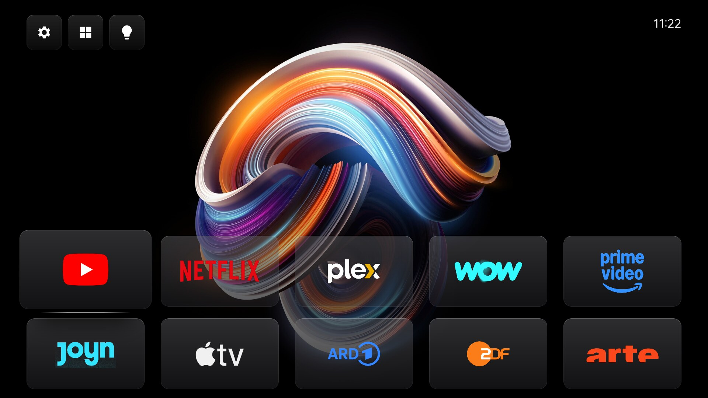

# lg-tv-home

A calmer, faster home for rooted LG webOS TVs. It replaces LG's home screen
with an Apple TV style launcher, switches off LG's tracking, trims background
bloat, lets you give the remote's buttons new jobs and adds an optional
Philips Hue connectivity. Every part is a module: pick only what you want in
one interactive installer, fully reversible.



Tested on an **LG OLED 2024 (OLED65G49LS) with webOS 25 (10.3.1)**. Other
webOS 22+ TVs will most likely work; parts that depend on the model are
skipped when they are missing. The TV must be rooted first, see
[docs/PREREQUISITES.md](docs/PREREQUISITES.md).

## What you get

Everything except TV Home itself is a module you can leave out (marked
*module*); TV Home's Settings, **Features** switches installed ones off and on.

| Feature | In short |
|---|---|
| **TV Home** | Wallpaper, large app tiles in their brand colour or on dark glass, folders, a smooth 60 fps. |
| **Organize Apps** | Move apps, make folders, add or remove apps, uninstall, reset. |
| **Wallpapers** | Your own pictures, from the TV or a USB stick, cropped on the TV to 16:9 at up to 4K; previews show the crop, and ✂ cuts a picture to its crop for good to save space (leave large for pan in Picture Frame). Optional: 16 public-domain museum prints (Monet, Turner, Cross, Twachtman), see [prints/CREDITS.md](prints/CREDITS.md). |
| **Picture Frame** *(module)* | Wallpapers full screen and dimmable, like a framed picture. Large pictures pan slowly; CH+/CH- change the picture, the arrows look around; pictures live in folders shared with the wallpaper menu, with one crop per picture set on the TV. Optionally it replaces LG's screensaver, and a key returns to the app you were in. |
| **Plex** *(module)* | Continue Watching from your Plex server above the apps (and new titles below them, if you like). OK resumes right where you stopped, without waiting for Plex to start. Each person signs in with their own Plex account, also on a server shared with them. |
| **Remote buttons** *(module)* | Netflix, Prime, Mic, Input, colour and number keys and more can be programmed to open any app or action. |
| **Hue** *(module)* | Rooms and lights in Settings, and a Light button that switches between scenes or the lighting from before (good for dimming lights). Paired on the TV, no computer needed. |
| **AV receiver button** *(module)* | One press sends the sound to the receiver or soundbar on HDMI eARC and wakes it, when the TV fell back to its own speakers. |
| **Privacy lock** *(module)* | Blocks LG's ad, tracking and ACR servers on the TV. That also locks the LG Store; an App Store switch in Settings opens it for 10 minutes when apps need updating. With a Pi-hole (or another network-wide block) you can leave it out. |
| **Tracking services** *(module)* | Stops LG's tracking and profiling services on the TV. |
| **Speed** *(module)* | Only the current and previous app stay in memory instead of 5 or 6 preloaded ones. Unused voice and smart home services can go too. |
| **Security** *(module)* | Turns off the passwordless root telnet that rooting leaves open. |
| **Help on the screen** | Hints use the remote's keys as symbols; a small **i** on screens with special controls opens a short legend in a corner. |

How to use everything: **[docs/FEATURES.md](docs/FEATURES.md)**.
How it works inside: [docs/HOW-IT-WORKS.md](docs/HOW-IT-WORKS.md).

## Install

On a Linux or macOS computer in the same network as the TV, with `ssh`,
`python3`, `curl` and `ar` (binutils) available:

```bash
git clone https://github.com/RYUJIN-ISO/lg-tv-home.git
cd lg-tv-home
./install.sh
```

The installer checks the TV and shows a checklist of the modules: switch
items with their numbers, or start from a preset (recommended, everything,
**Pi-hole user** = everything but the privacy lock, minimal). It asks a few
details, shows a summary and only then changes anything. Your choices are
saved in `setup.conf`, so after pulling an update `./install.sh --yes`
applies it without asking again.

To add or remove a module later, run `./install.sh` again and change the
checklist: modules you untick are taken off the TV (their settings, the Hue
pairing and the Plex sign-in stay, so ticking them again brings everything
back).

Hue is paired on the TV (Settings, Hue). From a computer, `TV=<your-tv> tools/hue-setup.sh` does the same.

## Undo

```bash
./uninstall.sh
```

This brings back LG's home screen, removes the apps and boot scripts and
restarts the stopped services. A reboot returns the rest to stock. The root
access itself stays.

## Installing with an AI agent

Point your agent (Claude Code, Codex and others) at this repo.
[AGENTS.md](AGENTS.md) tells it which questions to ask you, how to install
safely and what to watch out for.

## Tools

| Script | Use |
|---|---|
| `tools/hue-setup.sh` | Pair a Hue bridge, pick the room and the movie scene |
| `tools/bench.sh` | Measure how smooth the home screen is (moves the focus on screen for about 30 seconds) |
| `tools/screenshot.sh` | Save a screenshot of the TV |
