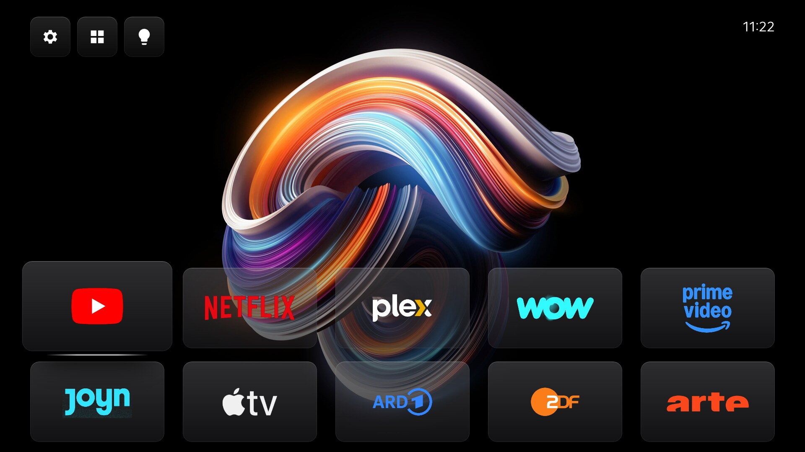

# Using TV Home

Everything works with the normal LG remote (arrows, OK, Back) and with the
Magic Remote pointer (hover, click, click and hold, scroll wheel). Lists and
menus wrap around: Up on the first entry jumps to the last one and back.

The features that are modules have their own pages: [Picture Frame](modules/picture-frame.md),
[Plex](modules/plex.md), [Philips Hue](modules/hue.md),
[Remote Buttons](modules/remote-buttons.md), [AV receiver button](modules/av-receiver.md),
[privacy lock and App Store](modules/privacy-lock.md).

## Home screen

- App cards start in the order LG had them. Your changes are saved on the
  TV (`/var/lib/webosbrew/atvhome/config.json`) and survive updates.
- **Back** jumps to the first row. **Home** always brings you back here.
- **Hold OK** on an app (about half a second) for quick options: move it, put
  it in a folder, remove it from the home screen.
- **Up** from the first row reaches the buttons at the top left:

| Button | What it does |
|---|---|
| **Settings** (gear) | Language, Look, Features (and App Store with the privacy lock) |
| **Organize Apps** (squares) | Switches edit mode on and off (green while on) |
| **Light** (bulb) | With [Philips Hue](modules/hue.md): cinema scene on / back. Hold OK: rooms and lights |
| **AV Receiver** (speaker) | With the [AV receiver button](modules/av-receiver.md): sound to the receiver on HDMI eARC |

Logos on the cards are sharp because TV Home cuts them out of the apps'
splash screens by itself: [Sharp logos](LOGOS.md).

## Settings

| Row | What it holds |
|---|---|
| **Language** | English or German |
| **Look** | How the home screen looks (below) |
| **Features** | Every module installed on this TV (below) |
| **App Store** | Only with the [privacy lock](modules/privacy-lock.md): opens LG's store, locks again when you leave it |

**Look.** Rows with arrows change with Left/Right:

| Setting | What it does |
|---|---|
| **Wallpaper** | The picture behind the home screen ([Pictures](#pictures)) |
| **Rotate Wallpaper** | **Off** (default) or **On**: a new wallpaper every 15 minutes, from Favourites when it holds two or more pictures, otherwise from all pictures. It changes while the home screen is on, or when it comes back after an app; never while a menu is open. Choosing a wallpaper by hand starts the 15 minutes again |
| **App cards** | **Glass** (default): dark glass cards like the top-left buttons, the logo on it in the brand's colour (white logos take the brand colour, lightened to read well; logos with their own colours keep them). **Colour**: each card in the app's brand colour |
| **Row spacing** | **Compact**, **Even** (default, the same as between the columns), **Roomy**, **Wide** |
| **Selected app** | What marks the focused app: **Bar** (default), a slim bar under it; **Name**; **Nothing** |
| **Bar colour** / **Bar brightness** | With Bar: white, blue, green, yellow, orange, red, pink or purple; 20 to 100 % |
| **Clock** | The clock at the top right |

**Features.** One row per installed module with On / Off. Each opens its own
menu: the **On / Off** switch on top, a line about what it does, and its
settings below, greyed out while it is off. Off hides the feature everywhere
and stops what it runs on the TV (Remote Buttons gives the buttons back to
LG, the Picture Frame no longer replaces the screensaver); its settings stay.
To take a module off the TV completely, run `install.sh` again and untick it
([Installing](INSTALL.md#changing-it-later)).

**Help.** Screens that do something a normal TV doesn't have a small **i**
next to the title (**Up** from the top row reaches it). It shows a small
legend in a corner: the remote keys drawn as key caps and a few words. It
doesn't block anything; **i** again or leaving the screen closes it. The home
screen's keys are in Settings' **i**.

## Organize Apps

Every tile gets a dashed outline and **OK opens its options directly**:

| On an app | On a folder |
|---|---|
| Move, Add to Folder, Remove from Home Screen, Uninstall | Open, Move, Rename, Choose Apps, Remove Folder |

The cards at the end of the grid:

- **Add Apps**: every installed app as a card, including the ones LG hid.
  A check mark means it is on the home screen, dimmed means it is not.
  OK switches it, Back is done.
- **New Folder**: give it a name, then tick its apps the same way.
- **Uninstall Apps**: OK marks apps (red bin), Back asks once for all of
  them. Homebrew Channel and the lg-tv-home apps are never offered, because
  removing Homebrew would lose root.
- **Reset Layout**: folders, order and the app selection go back to LG's.

**Move** works with the arrows; OK drops the tile. **Back** leaves edit mode,
every change is already saved.

## Pictures

Settings, **Look**, **Wallpaper** and the Picture Frame's **Pictures** open the
same picture library: the same folders, the same crops, the same screens.

- **Folders** as cards with a mosaic of their pictures: **All pictures**, your
  folders, **New Folder**, **From USB** (and **None** for the wallpaper).
  **Favourites** (right after All pictures) is built in: it holds the
  pictures marked ★, can be the frame's pictures, and can't be renamed or
  deleted.
  **OK** opens a folder. **Hold OK** on a folder: **Choose Pictures** (OK puts
  a picture in or takes it out), **Rename**, **Delete Folder** (the pictures
  stay). A picture can be in several folders.
- **Inside a folder**, OK does what the menu is for: from Wallpaper it sets
  the picture as the wallpaper (check mark), from Picture Frame it starts the
  frame with that folder, beginning at that picture.
- **⇅ in All pictures** (Up from the top row, left of the i): sort by
  **Name** (A–Z), **Uploaded** (when it came to the TV, newest first) or
  **Date taken** (from the photo's EXIF or a date in its file name, newest
  first; pictures without one go last). From Phone reads the date on the
  phone before it scales the picture, so it isn't lost. Folders keep their order.
  Under **Filter**, **Duplicates only** shows just the pictures that look
  like another one in the library (the same test as From Phone, below), each
  group side by side, so you can delete the extra copy (hold OK).
- **Hold OK on a picture**: **View in Gallery**, **Favourite** (☆/★), **Crop**, which **folders** it is in, and
  **Delete Picture** (asks first; removes it from the TV and all folders;
  not offered for the pictures that come with the app).
- **View in Gallery**: the picture fullscreen with the pictures of the grid
  you came from (same order) as a row of previews at the bottom. **Left** /
  **Right** go through them, **OK** hides or shows the row, **hold OK** opens
  the picture's options (crop, delete, favourite …), **Back** closes. The
  preview shows at once; the full picture follows when you rest on one.
- **Crop**: a 16:9 frame over the whole picture. It opens in the bar:
  smaller, larger, how sharp it is (**4K**, or how much it gets enlarged),
  **Reset**. **Up** moves to the frame: the arrows move it (or drag it with
  the Magic Remote, the wheel resizes), **OK** saves and goes back to the bar,
  **Back** goes back without saving. **↻** turns the picture a quarter to
  the right (for a sideways photo; a picture stored on the TV is saved turned
  a moment after the last press, its crop starts over). **✂** (pictures stored on the TV) cuts
  the file to the frame for good, after a confirmation, to save space when
  only the crop is worth keeping; it can't be undone. The crop is remembered, never cut into the file, and
  used everywhere: the home screen shows it, the picture frame rests on it
  (Still) or glides towards it (Pan).
- **From Phone** shows a QR code. Scan it with the phone's camera (phone and
  TV in the same network) and choose pictures on the phone. The phone's page
  shows them under **New**. A picture that looks like one already on the TV
  shows that TV picture beside it and starts left out, so you can see
  whether it is the same; tap a picture to add it or leave it out, then
  **Add … to the TV**. "Looks like" = the same name (ignoring the -12345
  imports add), the same fingerprint (a 64-bit sketch of the picture; the
  phone makes it, the TV makes its own once, in the background, the first
  time the picture library opens) or taken at the same second. Android's
  picker sends most photos with a number as their name, so names alone miss
  them. They go straight into All Pictures, uncropped (crop them later, hold
  OK on a picture), and show up next to the code. The phone sends them
  already turned upright and scaled to about 18 megapixels, as JPEG: anything the phone can show (JPG, PNG, HEIC, WebP …) works; RAW files (DNG, CR2, NEF …) don't, save them as JPEG first. The phone's
  page only opens with the code's random address, and the TV stops listening
  15 minutes after the last request. Refused when less than 150 MB would be left on the TV.
- **From USB** shows the pictures (JPG, PNG) on a USB stick. OK opens the crop
  screen; **OK** in the frame adds the whole picture (scaled down to about 18 megapixels
  when it is bigger) with its crop and a preview. From Wallpaper it also
  becomes the wallpaper.

**Museum prints** (installer checklist, or copy `prints/` from the repo): 16
public-domain paintings by Monet, Turner, Henri-Edmond Cross and Twachtman,
uncropped, up to 16 megapixels, with previews. Ten have enough detail for a
sharp 4K frame across their width; the smaller six get enlarged slightly when
they fill the screen. Credits: `prints/CREDITS.md`.

Wallpapers can also be copied straight to `/var/lib/webosbrew/atvhome/wallpapers/`
on the TV (3840x2160 looks best: the TV draws the home screen at 4K).
