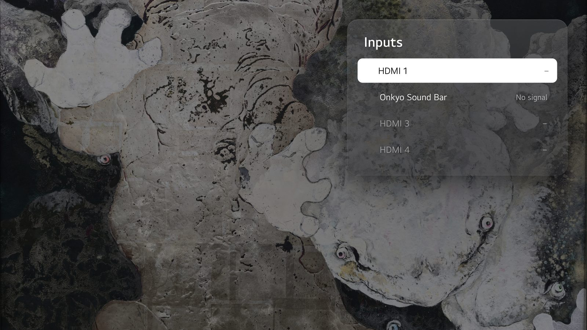
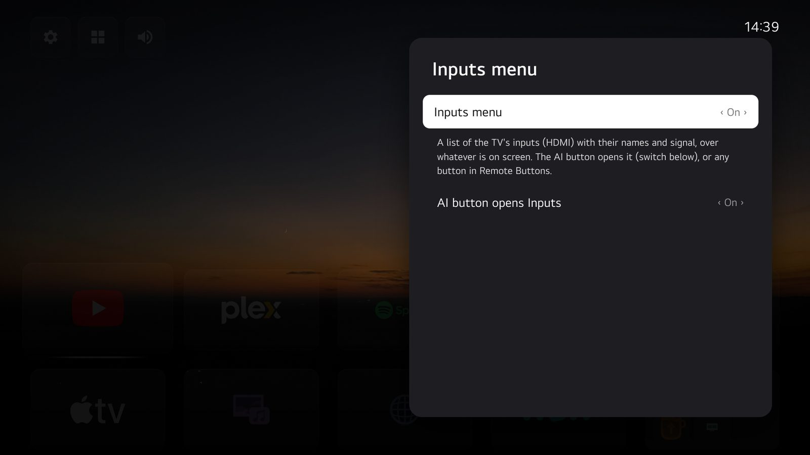

# Inputs menu

A small glass menu with all of the TV's inputs (HDMI) by their names, e.g.
"PC" or the receiver, and whether the device on each sends a picture. It
opens **over whatever is on screen**: a game or film on HDMI keeps playing
behind it. OK switches to an input. Meant for a remote button, since most
Magic Remotes have no Input button.

| | |
|---|---|
| Installer | **Inputs menu** (`INPUTS`), part of TV Home |
| Switch | Settings, **Features**, **Inputs menu** |
| On the TV | the overlay app `com.iso.inputs`; the AI button switch is an entry in the remote mapper's `map.json` |
| Removed by | unticking it in `install.sh` (buttons set to it are cleared too) |

## Using it

Settings, Features, **Inputs menu**, **AI button opens Inputs**: On puts the
menu on the AI (mic) button, Off gives the button back (needs Remote
Buttons). Any other button works too: Settings, Features, **Remote
Buttons**, pick the button, then **Inputs menu** in the actions.

- **Up / Down** (or the pointer, or the wheel) pick an input; the one on
  screen has a tick.
- **OK** switches to it.
- **Back**, **Left** or the **same button again** close the menu.

| Value | Meaning |
|---|---|
| ● Signal | a device is connected and sends a picture |
| No signal | a cable is plugged in, but the device is off or asleep |
| – | nothing plugged in (greyed) |

The names are the ones LG shows (rename an input in LG's input settings and
the menu follows). The language follows TV Home's.

## How it works

`apps/inputs-overlay` is a web app with `"defaultWindowType": "overlay"` and
`"transparent": true`, like LG's own overlay menus (settings, notification
center): surface-manager puts its window on top of the current app or input
instead of switching to it. It subscribes to
`luna://com.webos.service.eim/getAllInputStatus` (label, `hdmiPlugIn`,
`hdmiSignalExist`, the input's app) and launches the chosen input's app
(`com.webos.app.hdmi1` ...); `window.close()` hides it again. The input on
screen comes from `applicationManager/getForegroundAppInfo` (via Homebrew's
exec).

The glass has no backdrop blur: webOS composites each app's window and the
HDMI video plane separately, so a page can't blur what is behind it. The
picture behind is dimmed instead.

The TV Home side (`apps/tv-home/modules/inputs/`) is only the Features entry
with the AI button switch and the Remote Buttons action. TV Home also
watches the input status itself, so a new input card (LG turns HDMI 4 into
"PC" when a PC is plugged in) shows up on the home screen right away.
